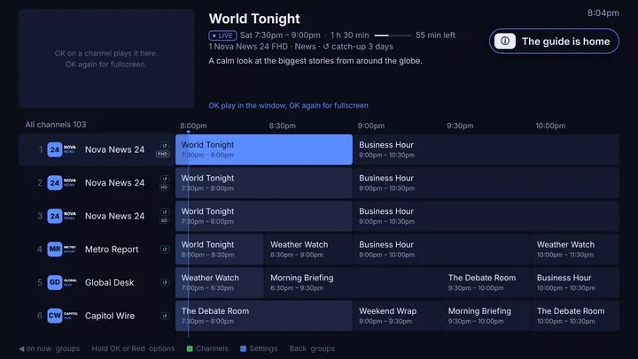
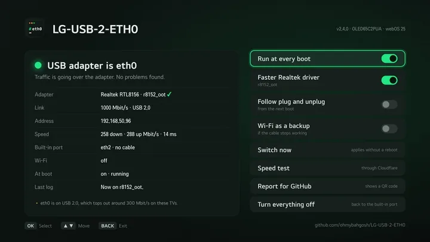
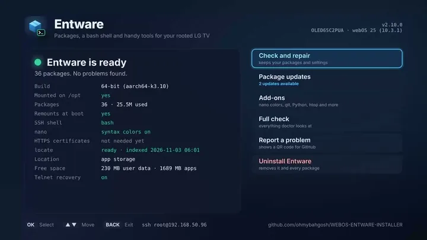
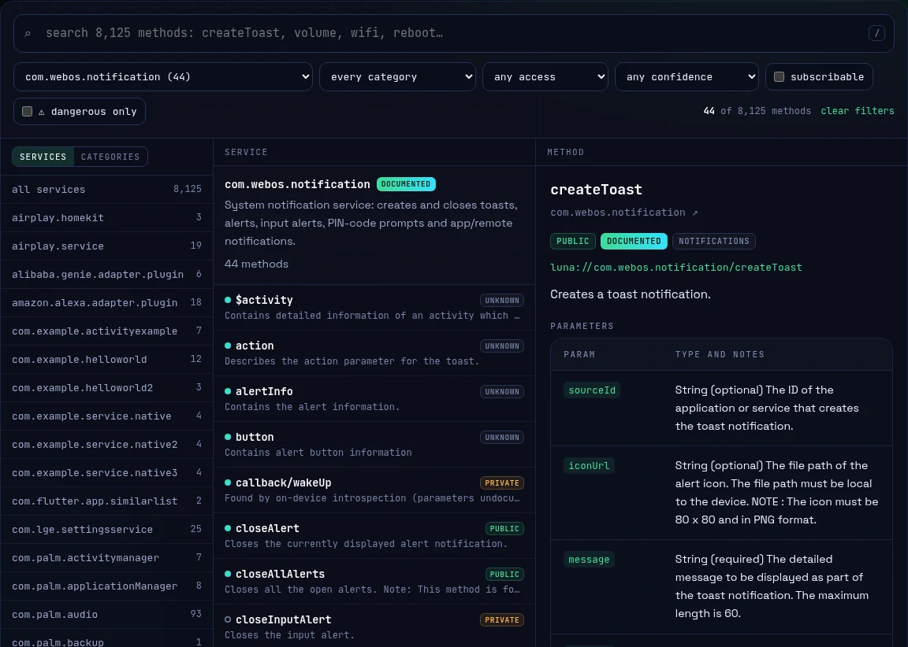

<div align="center">

<a href="https://ohmybahgosh.dev"></a>

[](https://ohmybahgosh.dev)
[](https://ohmybahgosh.dev/about/)
[](https://ohmybahgosh.dev/#homebrew)
[](https://ohmybahgosh.dev/contact/)

**Data engineer by day.  Pentester, automator and builder of open-source LG webOS tools by night.  AI-assisted, human-audited.**

</div>

## whoami

I'm **OhMyBahGosh**.  I like hoarding data, finding things and solving problems.

By day I'm a data engineer, and the Swiss Army knife of the team.  On any given day that means data pipelines, Google Ads, full-stack Shopify development, automation or AI tooling, usually more than one before lunch.  I've been building for the web for more than 17 years, with a background in security and software development.

Off the clock I'm into penetration testing and network security: finding the weak spot before someone else does.  I also automate anything that holds still long enough.

That's how my TV ended up running a homebrew IPTV player I wrote because the one I wanted didn't exist on webOS.  Its Ethernet port is a USB adapter pretending to be the built-in one.  It has a full Linux toolbox installed, and a remote dedicated server keeps the media flowing.  All three of those are now apps anyone can install from the Homebrew Channel.  And when I wanted to know what else the TV could do, I mapped every `luna-send` command it answers to.

## Current focus: LG webOS homebrew

```console
$ ls projects/
tivibro/  usb-2-eth0/  entware/  luna-atlas/  pipseek/
```

Three apps for LG TVs, each built to solve a problem I had, plus Luna Atlas, a map of everything the TV's system services answer to.  The apps install from the Homebrew Channel and run with the remote, work over SSH too, are tried on a real TV before every release, and remove cleanly.

###  [TiviBro](https://ohmybahgosh.dev/tivibro/)

<a href="https://ohmybahgosh.dev/tivibro/"></a>

The IPTV player LG TVs never got.  Free and TiviMate-style for webOS 4 and up: guide-first, catch-up, movies and shows, sports and PPV, a web editor for your phone and an Android remote.  Bring your own Xtream Codes or M3U.

[](https://github.com/ohmybahgosh/TiviBro/releases)
[](https://github.com/ohmybahgosh/TiviBro)

[Page](https://ohmybahgosh.dev/tivibro/) · [Repo](https://github.com/ohmybahgosh/TiviBro) · [tivibro.app](https://tivibro.app/?utm_source=github&utm_medium=referral&utm_campaign=readme&utm_content=profile)

<br>

###  [LG-USB-2-ETH0](https://ohmybahgosh.dev/lg-usb-2-eth0/)

<a href="https://ohmybahgosh.dev/lg-usb-2-eth0/"></a>

Makes a USB Ethernet adapter the TV's `eth0`, so settings and streaming apps use the faster wired link: two to three times the built-in port.  Finds, checks and installs a Realtek or ASIX driver for your exact TV, and can keep Wi-Fi as a backup.

[](https://github.com/ohmybahgosh/LG-USB-2-ETH0/releases)
[](https://github.com/ohmybahgosh/LG-USB-2-ETH0)

[Page](https://ohmybahgosh.dev/lg-usb-2-eth0/) · [Repo](https://github.com/ohmybahgosh/LG-USB-2-ETH0)

<br>

###  [Entware](https://ohmybahgosh.dev/webos-entware-installer/)

<a href="https://ohmybahgosh.dev/webos-entware-installer/"></a>

A real Linux toolbox for rooted webOS: hundreds of packages, a bash shell, package updates and one-press add-ons like git, Python, htop and a login banner.  Lives on the TV's roomy app storage and uninstalls cleanly.

[](https://github.com/ohmybahgosh/WEBOS-ENTWARE-INSTALLER/releases)
[](https://github.com/ohmybahgosh/WEBOS-ENTWARE-INSTALLER)

[Page](https://ohmybahgosh.dev/webos-entware-installer/) · [Repo](https://github.com/ohmybahgosh/WEBOS-ENTWARE-INSTALLER)


<br>

###  [Luna Atlas](https://ohmybahgosh.dev/luna-atlas/)

<a href="https://ohmybahgosh.dev/luna-atlas/"></a>

Every LG webOS `luna-send` command in one searchable place: 8,167 methods across 501 services, each with its access level, a confidence flag, its parameters where they're known and a ready-to-run command.  Search and filter it right on the page, and link to any method.  A TV app and command-line tool that read the same catalog are early previews.

[](https://ohmybahgosh.dev/luna-atlas/)
[](https://github.com/ohmybahgosh/WEBOS-LUNA-SEND-ATLAS)

[Page](https://ohmybahgosh.dev/luna-atlas/) · [Repo](https://github.com/ohmybahgosh/WEBOS-LUNA-SEND-ATLAS)


**Get all three apps at once:** on a rooted LG TV, open the Homebrew Channel, go to Settings, choose **Add repository** and enter `https://ohmybahgosh.dev/repo`.  New releases show up there as updates.

## Yes, I vibe code.  Not blindly.

Not the blind kind, where you paste whatever a model hands you and hope.  AI lets one person build in a weekend what used to take a team a month, and that's a real shift worth using.  But speed without scrutiny is how you ship bugs and security holes at scale.  So everything here gets the same treatment as hand-written code: I design it first, read every line, test it on real hardware, and audit it the way someone who breaks things for fun would.  The AI writes faster.  The judgment is still mine.

Commits list me as the author and Claude as the committer, so the AI's part is right there in the history.  [How these projects are built](https://ohmybahgosh.dev/#built).

## Also on GitHub

| | |
|---|---|
| 🔎 **[pipseek](https://ohmybahgosh.dev/pipseek/)** | Search PyPI from your terminal.  An interactive replacement for the retired `pip search`, with full-text search, popularity ranking, package details and JSON output.  [Repo](https://github.com/ohmybahgosh/pipseek) |
| 🔐 **[RockYou2021.txt](https://github.com/ohmybahgosh/RockYou2021.txt)** | A large password-auditing wordlist used for security testing.  Words only, no logins. |
| 🖥️ **[Seedbox Tweaks and Optimizations](https://github.com/ohmybahgosh/Seedbox-Tweaks-and-Optimizations)** | Scripts and configs from years of running a seedbox: rclone mounts, nginx, Plex settings and more. |
| 🎮 **[Plex skip-intro D-pad fix](https://github.com/ohmybahgosh/NVIDIA-SHIELD-PLEX-DPAD-KEYLAYOUT)** | Makes a D-pad's OK button actually press Skip Intro in Plex on Android TV.  Also as a [Magisk module](https://github.com/ohmybahgosh/PLEX_SKIP_INTRO_DPAD_CONTROLLER_FIX). |
| 📼 **[YT-DLP-SCRIPTS](https://github.com/ohmybahgosh/YT-DLP-SCRIPTS)** | A pile of yt-dlp scripts that were cutting-edge back when they worked.  Now historical artifacts, preserved for science.  Run them at your own nostalgia. |

## How I share things

Everything I publish is free and open source, written in plain language, and built to check before it touches anything and to clean up after itself.  No donations, no paywalls: I build these for fun and share them in case they help someone else too.  If something breaks, [tell me](https://ohmybahgosh.dev/contact/).  That's how it gets better.  Unless it's the yt-dlp scripts.  Those are already broken.

<div align="center">
<br>
<sub><a href="https://ohmybahgosh.dev">ohmybahgosh.dev</a> · <a href="https://ohmybahgosh.dev/contact/">hello@ohmybahgosh.dev</a> · Not affiliated with LG Electronics.</sub>
</div>
